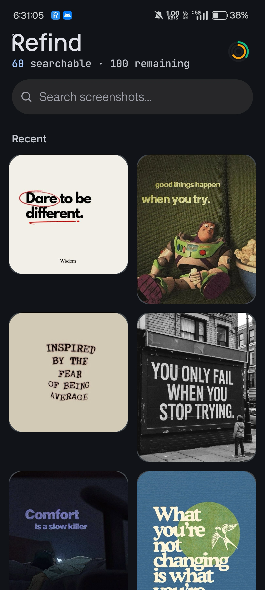
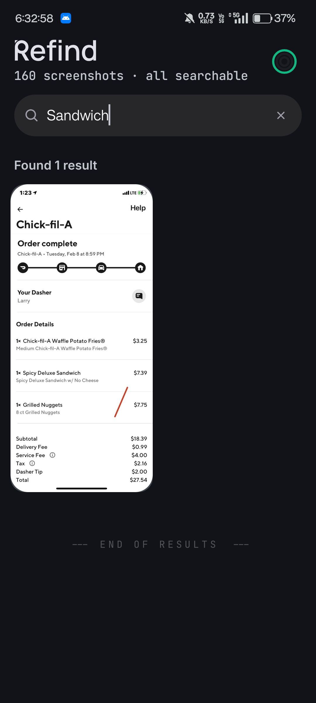
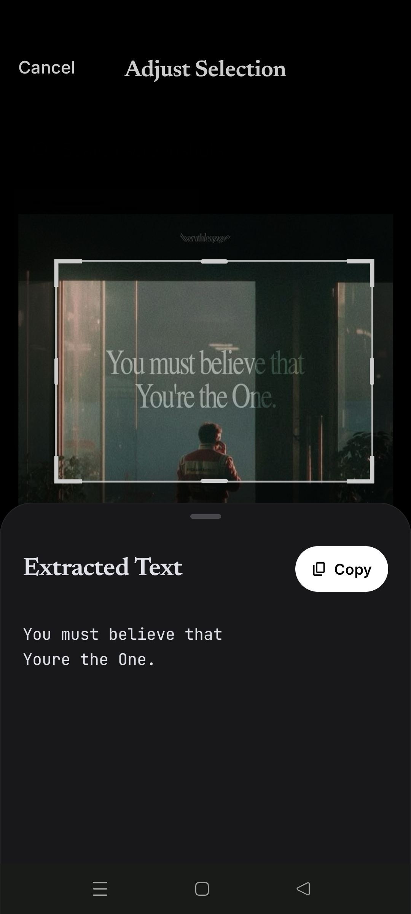
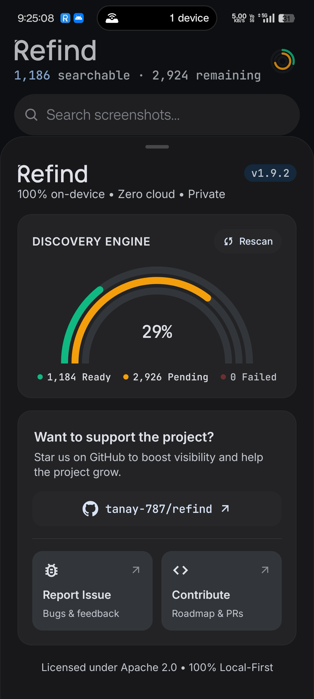
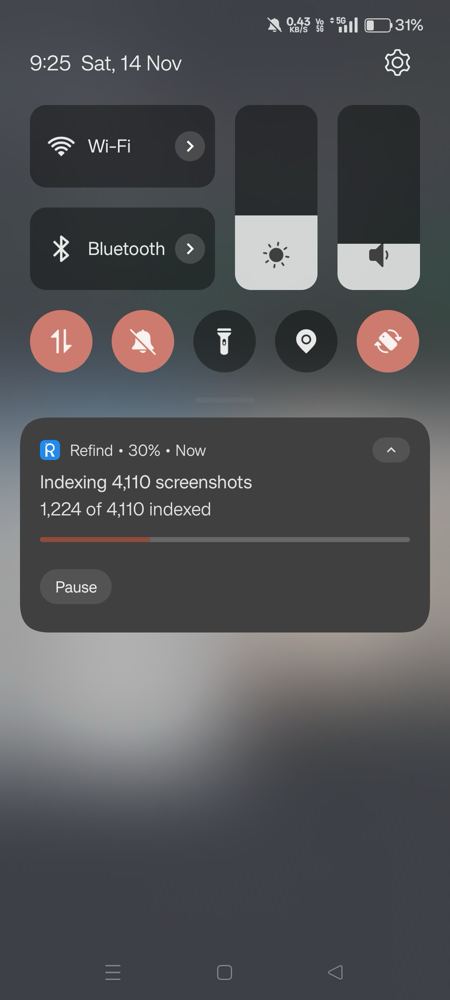

<p align="center">
  
</p>

# Refind

> **Every word inside your screenshots. Fully searchable, entirely on-device.**  
> 100% on-device, private recall search for screenshots powered by local ML Kit OCR and SQLite FTS5.

[](LICENSE)
[-green.svg)](https://developer.android.com)
[](https://github.com/tanay-787/refind/releases)
[](https://github.com/tanay-787/refind/actions)
[](https://api.obtainium.imranr.dev/redirect?r=https://github.com/tanay-787/refind)

---

You see something worth remembering.  
You take a screenshot.  
You move on.

---

A few days pass. The moment you actually need it arrives, and you remember exactly what it was. A receipt. A travel itinerary. A quote that stopped you mid-scroll. You know precisely what you're looking for.

So you open your gallery.

And you scroll.

And you scroll.

And somewhere in the slow, quiet frustration of that search, you realize: **the problem was never the screenshot. It was finding it again.**

---

## This is Refind.

Not a gallery. Not a photo manager.  
A memory, made searchable.

The name is deliberate. You're not discovering something new, you're **refinding** something you already knew. Refind meets you at that moment, the one where the memory is clear but the file is buried, and it gives you back the thing you came for. Instantly.

Type what you remember. Not a date. Not a folder. Just the words, the way you actually think about it. Refind searches the content *inside* your screenshots: the text, the context, the meaning. And it surfaces exactly what you were looking for.

---

## The philosophy.

Every screenshot you take is an act of intention. You paused, you noticed something worth keeping, and you captured it. That moment deserves to be honored — not buried in an infinite grid of thumbnails.

Refind starts from a simple belief: **you should be able to find anything you once chose to remember.**

**No cloud. No server. No account.**  
The cloud does not deserve to see your life. Your flight bookings, medical receipts, order confirmations, and private notes belong on your silicon, inside your pocket, protected by your lock screen.

---

## ⏱️ Design Philosophy: Instrument-Grade Software

Most software swings between two frustrating extremes:
1. **Paternalistic Simplicity**: Dumbing down interfaces to the point where power users are blinded—stripping away numbers, hiding telemetry, and treating users like toddlers who can't handle the truth of their device.
2. **The Spaghetti Extreme**: Dumping raw, hostile toggles, unstyled logcats, and cognitive chaos everywhere.

Refind takes a third path: **Instrument-Grade Software**.
- **Surface Elegance**: Fluid 120Hz spring physics, disciplined typography, edge-to-edge layout, and instantaneous search-as-you-type. The technology gets out of your way.
- **Mechanical Honesty**: We don't hide the machine from you. The 180° radial arc gauge in the header gives you a live, analog-precision tachometer of your library's indexing state (`Ready • Pending • Failed`), rendered in crisp **JetBrains Mono**. It gives you a cockpit, not an idiot light.
- **Structural Integrity**: Zero cloud dependencies. Every OCR token, trigram index, and search score is computed directly on your phone's processor.

---

## 📸 Interface

<p align="center">
  
  
  
  
  
</p>

---

## ✨ Features

- 🔍 **Private Recall Search**: Search screenshots using natural words you remember. A dual-leg SQLite FTS5 prefix and trigram tokenization engine with dynamic query-conditioned reranking surfaces results instantly as you type.
- 🔎 **On-Demand Text Extraction**: Tap into any screenshot in the viewer to crop and scan text on demand. Surfaces extracted text cleanly in a bottom sheet with 1-tap copy and share. *(Interactive bounding box overlay on the roadmap).*
- ⚡ **In-Tree Kotlin OCR Module (`expo-mlkit-ocr`)**: Built using Kotlin coroutines and modern Expo Modules JSI bindings. Bundles offline Google ML Kit models (**Latin / English** script, with Devanagari on the way) directly at the native Gradle level for high-throughput (~2 screenshots/sec) indexing with zero network latency.
- 🛡️ **Durable Background DAG Pipeline (`JobJournal`)**: Resumable, crash-resilient background processing orchestrator with SQLite-backed state tracking, lease-based locking, and foreground notification controls (Pause/Resume/Progress) to prevent Android Doze kills.
- 🔒 **Zero Cloud, Zero Telemetry**: Refind does not communicate with external servers. Your screenshots, metadata, and extracted text never leave your device.
- 📱 **Native Material You UX**: Edge-to-edge design, fluid gesture interactions (pinch-to-zoom, pan, swipe-to-dismiss), and adaptive dark/light Material You theming built with HeroUI Native.

---

## 🔒 Permissions & Privacy

Refind requests only the minimal permissions required to index and search screenshots locally:

| Permission | Why Refind Needs It |
|---|---|
| `READ_MEDIA_IMAGES` / Storage | Detects newly taken screenshots and displays them in the viewer. |
| `FOREGROUND_SERVICE` & `FOREGROUND_SERVICE_DATA_SYNC` | Ensures Android does not terminate OCR and SQLite indexing workers while processing screenshots. |
| `POST_NOTIFICATIONS` | Displays indexing progress and provides notification action buttons to pause or resume background jobs. |
| `ACCESS_MEDIA_LOCATION` | Preserves screenshot metadata for chronological ordering. |

> **Privacy Guarantee**: Refind contains no tracking SDKs, no ad networks, and no analytics. Refind will never upload your photos, extracted text, or search queries.

---

## 📦 Installation & Distribution

- **Direct APK**: Download the standalone signed APK from [GitHub Releases](https://github.com/tanay-787/refind/releases/latest).
- **Auto-Updates via Obtainium**: Refind supports 1-click install and automated background update notifications directly from GitHub Releases using [Obtainium](https://github.com/ImranR98/Obtainium):  

  [](https://api.obtainium.imranr.dev/redirect?r=https://github.com/tanay-787/refind)

---

## 🏗️ Architecture

```
Android MediaStore (Screenshots)
               │
               ▼
   [01 Source Discovery] ──> [02 Intake & Metadata Batching]
                                        │
                                        ▼
                              DURABLE STAGE DAG
                              ┌──────────────────────────────────┐
                              │  [Stage 01: Native OCR]          │ (expo-mlkit-ocr Kotlin/JSI)
                              │             │                    │
                              │             ▼                    │
                              │  [Stage 02: Postprocess]         │ (Cleaning, Script Detection)
                              │             │                    │
                              │             ▼                    │
                              │  [Stage 03: Keywords]            │ (TF-IDF & Token Expansion)
                              │             │                    │
                              │             ▼                    │
                              │  [Stage 04: Index FTS5]          │ (Trigram + Standard FTS5)
                              └──────────────────────────────────┘
                                        │
                                        ▼
                           [Query-Conditioned Recall Search]
```

For in-depth details on the pipeline DAG, see [`MODULE_STRUCTURE.md`](src/core/jobjournal/MODULE_STRUCTURE.md) and the [`.docs/`](.docs/) directory.

---

## 🛠️ Development & Building from Source

### Prerequisites

- **Node.js**: `22.x` or later
- **Package Manager**: `pnpm` (v9 or v10)
- **Java Development Kit**: JDK 17
- **Android SDK**: Android SDK Platform 34+ and NDK

### Setup

```bash
# Clone the repository
git clone https://github.com/tanay-787/refind.git
cd refind

# Install dependencies
pnpm install

# Start development bundler
pnpm start

# Or start with tunnel (subdomain: refind)
pnpm dev:tunnel

# Run type check & linter
pnpm type-check
pnpm lint
```

### Local APK Compilation

```bash
# Compile a local Android Debug APK
pnpm compile:apk --debug

# Compile a local Android Release APK
pnpm compile:apk --release
```

---

## 🤝 For Contributors

Please see [CONTRIBUTING.md](CONTRIBUTING.md) for full guidelines on setup, branch workflows, and privacy principles.

### Commit Convention

This project follows the [Conventional Commits](https://www.conventionalcommits.org/en/v1.0.0/) specification, enforced locally via `husky` and `commitlint`.

| Type | Description | Version Impact |
|------|-------------|----------------|
| `feat` | A new feature | Minor bump |
| `fix` | A bug fix | Patch bump |
| `docs` | Documentation changes |, |
| `style` | Formatting, whitespace |, |
| `refactor` | Code restructure, no feature change |, |
| `perf` | Performance improvements |, |
| `test` | Test additions or corrections |, |
| `chore` | Build process or tooling changes |, |

**Format:**
```
<type>(<scope>): <description>

[optional body]

[optional footer(s)]
```

### Releases

Releases are managed automatically by [Release Please](https://github.com/googleapis/release-please).

1. Push `feat` or `fix` commits to `master`, a Release PR is created or updated automatically.
2. The PR bumps the version in `package.json` and `app.json`, and updates `CHANGELOG.md`.
3. Merging the Release PR creates a GitHub Release and tags the commit, triggering the automated APK build workflow.

---

## 📜 License

Licensed under the [Apache License, Version 2.0](LICENSE).
